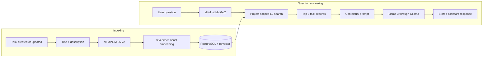
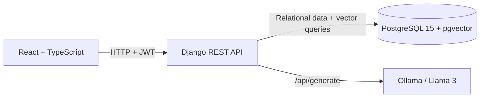

# Project RAG Tracker

Project RAG Tracker is a portfolio project that combines a multi-project Kanban board with a project-scoped Retrieval-Augmented Generation (RAG) assistant. Users organize work as columns and tasks, while the assistant retrieves semantically relevant task information before asking a locally hosted Llama 3 model to answer questions about the selected project.

## Overview

A conventional Kanban board makes current work visible, but finding related information still depends on exact wording and manual browsing. This project adds semantic retrieval to the board: every task is embedded when it is saved, and questions are matched against task embeddings belonging to the current project.

The application demonstrates a complete local full-stack flow across a React interface, an authenticated Django REST API, relational project data, vector search in PostgreSQL, and local text generation through Ollama.

## Key Features

- **Project management** — authenticated users can create, list, open, and delete their own projects.
- **Kanban boards** — create, rename, reorder, and delete columns within a project.
- **Task management** — create, edit, move, reorder, and delete tasks.
- **Drag and drop** — `dnd-kit` supports column reordering, task reordering, and moving tasks between columns.
- **JWT authentication** — access and refresh tokens protect the application routes and project API.
- **Owner-scoped project data** — project, column, and task querysets are filtered through the authenticated project owner.
- **Automatic task embeddings** — a Django `post_save` signal regenerates a task embedding after every task create or update.
- **Semantic retrieval with pgvector** — questions are compared with project-scoped task vectors using Euclidean (L2) distance.
- **Project RAG assistant** — the three closest task records are assembled into context for Llama 3.
- **Persistent chat history** — user questions and assistant responses are stored by project and user.
- **Local LLM inference** — generation is sent to a local Ollama service rather than an external hosted API.
- **Dockerized services** — Compose defines the frontend, backend, PostgreSQL/pgvector, and Ollama services.

## Project Preview

Screenshots are intentionally not included until they can be captured from the running application.

<!-- Recommended screenshot: the authenticated project list with several projects. -->
<!-- Recommended screenshot: a populated Kanban board showing columns, task cards, and drag-and-drop state. -->
<!-- Recommended screenshot: the project board with the RAG chat answering a question from task context. -->

Future screenshots belong in [`docs/images/`](docs/images/).

## How the RAG Pipeline Works

The implementation maintains one embedding per task. The same SentenceTransformer model is used for stored tasks and incoming questions.



See [RAG Pipeline](docs/rag-pipeline.md) for the exact indexing, retrieval, prompt, and persistence behavior.

## Architecture



The browser owns presentation and interaction state. Django enforces the API's authenticated project scope, persists domain data, creates embeddings, performs retrieval, and orchestrates generation. PostgreSQL stores both relational records and vectors; Ollama runs the local language model.

## Tech Stack

### Frontend

- React 19 and TypeScript
- Create React App / `react-scripts`
- Material UI and Emotion
- React Router
- Axios
- `dnd-kit`
- `jwt-decode` and Day.js for token handling

### Backend

- Python 3.11 container image
- Django and Django REST Framework
- Simple JWT and Djoser
- `django-cors-headers`
- `requests` for Ollama communication

### AI / RAG

- Sentence Transformers
- `all-MiniLM-L6-v2` embeddings
- 384-dimensional task vectors
- pgvector L2 similarity search
- Ollama with the `llama3` model

### Data

- PostgreSQL 15 through the `pgvector/pgvector:pg15` image
- Django ORM
- pgvector's Django integration

### Infrastructure

- Docker and Docker Compose
- Separate frontend, backend, database, and Ollama services
- Named volumes for PostgreSQL data and downloaded Ollama models

## Repository Structure

```text
.
├── backend/
│   ├── api/                 # Domain models, REST viewsets, serializers, signals, and migrations
│   ├── myproject/           # Django settings and root URL configuration
│   ├── users/               # User API serializer and viewset
│   ├── Dockerfile
│   └── manage.py
├── frontend/
│   ├── public/              # Create React App static assets
│   ├── src/                 # Routes, Kanban UI, authentication, chat, and user administration UI
│   └── Dockerfile
├── docs/                    # Architecture, RAG, and development documentation
└── docker-compose.yml       # Four-service local topology
```

## Running Locally

The repository is configured as a development environment. It uses Django's development server and the Create React App development server; it is not a production deployment definition.

### Prerequisites

- Docker with Docker Compose
- An Ollama-compatible machine with enough resources to run `llama3`
- Optional: Node.js 20 and npm if running the frontend outside Docker

### 1. Configure database credentials

Create an ignored `.env` file in the repository root. Compose reads these three values:

```dotenv
DB_NAME=project_db
DB_USER=project_user
DB_PASS=choose-a-local-password
```

### 2. Start the data, LLM, and API services

```bash
docker compose up --build -d db ollama backend
```

On a first start, the backend may need to be restarted if PostgreSQL is not ready before Django starts; the current Compose file declares service ordering but no database health check.

### 3. Initialize the database and login user

```bash
docker compose exec backend python manage.py migrate
docker compose exec backend python manage.py createsuperuser
```

The first migration enables the PostgreSQL vector extension. The created Django user can sign in through the application.

### 4. Download the generation model

```bash
docker compose exec ollama ollama pull llama3
```

The SentenceTransformer model is loaded by the backend and may be downloaded the first time the Django process starts.

### 5. Start the frontend with its API URL

The React code expects `REACT_APP_API_URL`, but the current Compose service does not inject it. Without changing repository configuration, start the existing frontend service as a one-off container with the variable supplied at runtime:

```bash
docker compose run --rm --service-ports -e REACT_APP_API_URL=http://localhost:8000 frontend
```

Alternatively, run it on the host:

```bash
cd frontend
npm install
REACT_APP_API_URL=http://localhost:8000 npm start
```

In PowerShell, set the variable before starting npm:

```powershell
cd frontend
npm install
$env:REACT_APP_API_URL = "http://localhost:8000"
npm start
```

Open [http://localhost:3000](http://localhost:3000). The API is exposed at `http://localhost:8000`, PostgreSQL at host port `5433`, and Ollama at `http://localhost:11434`.

For more detail, see [Development Guide](docs/development.md).

## Documentation

- [Architecture](docs/architecture.md) — component responsibilities, request flows, domain model, and container topology.
- [RAG Pipeline](docs/rag-pipeline.md) — exact indexing, retrieval, prompt construction, generation, and chat persistence behavior.
- [Development Guide](docs/development.md) — prerequisites, services, ports, first-run steps, and current setup constraints.
- [Frontend Guide](frontend/README.md) — concise notes on the React application.

## Current Scope

This repository is a technical portfolio project. It demonstrates full-stack development, REST API design, JWT-based sessions, relational data modeling, drag-and-drop React interactions, vector storage and retrieval, RAG orchestration, local LLM integration, and multi-service Docker development. The checked-in configuration is intentionally presented as the current development implementation, not as a production-ready system.
