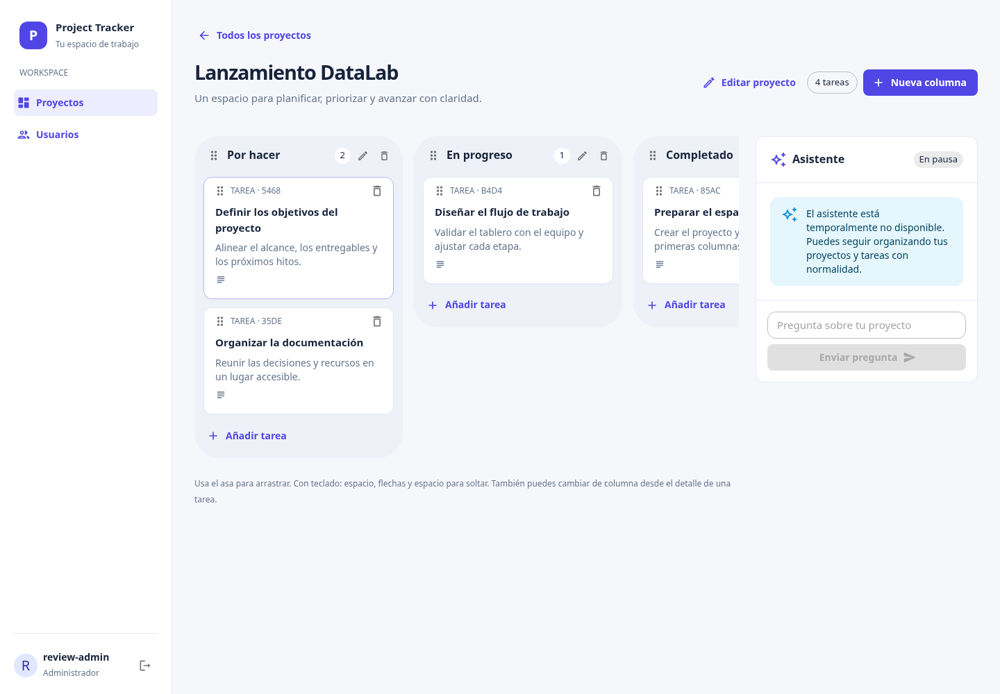

# Project RAG Tracker

Gestión de proyectos con React, TypeScript, Material UI, Django REST Framework y PostgreSQL/pgvector. La instalación inicial de DataLab funciona **sin GPU, Ollama ni descargas de modelos**. La IA es opcional y está deshabilitada por defecto.

## Desarrollo

Requisitos: Node 22.12+ (imagen Node 22), Python 3.11+ y PostgreSQL con pgvector. El frontend usa Vite: arranque rápido, compilación TypeScript explícita y pruebas Vitest, sin cambiar React ni los contratos CRUD.

```bash
cp .env.example .env  # completar DB_PASS; nunca subir este archivo
# El Compose de desarrollo activa DEBUG; no usarlo en un servidor.
docker compose up -d --build db backend
docker compose exec backend python manage.py migrate
docker compose exec backend python manage.py createsuperuser
docker compose up frontend
```

Frontend: puerto local 3000; Django: puerto local 8000. Para ejecutar React en el host:

```bash
cd frontend
npm ci
npm start
npm test
npm run build
```

El proxy Vite reenvía `/api` y `/auth` al Django local. `VITE_API_URL` permite configurar otro origen en desarrollo; en producción se usa el mismo origen HTTPS. Las variables de Vite son públicas y se incorporan al build: nunca contienen secretos. `REACT_APP_API_URL` ya no se utiliza.

## Despliegue manual en DataLab (Ubuntu, 8 GB RAM, HDD, sin GPU)

No se ha desplegado en un servidor real. Los comandos siguientes se ejecutan manualmente en el directorio de esta aplicación. No reemplazar el Nginx, PostgreSQL, redes o volúmenes de otros servicios.

El Compose de producción usa un proyecto independiente `rag-tracker-prod`, PostgreSQL **16 con pgvector** sin puerto publicado y un volumen propio. No hay `container_name` ni red externa compartida. Solo Nginx del frontend escucha en `127.0.0.1:8095`; cambia `APP_PORT` si está ocupado. Los servicios esenciales no dependen de Ollama. No uses `docker system prune`, `down -v` ni volúmenes de otros proyectos.

### 1. Configuración

```bash
cp .env.example .env.prod
chmod 600 .env.prod
# Generar valores únicos localmente y colocarlos en .env.prod:
python3 -c 'import secrets; print(secrets.token_urlsafe(64))'
```

Genera valores diferentes para `DJANGO_SECRET_KEY` y `DB_PASS`. Completa el nombre DNS real en `ALLOWED_HOSTS` (incluye `localhost` para el healthcheck) y el origen HTTPS en `CSRF_TRUSTED_ORIGINS`. Mantén los tres indicadores de IA en `false`. No copies las credenciales del PostgreSQL existente. Cambiar `DB_PASS` después de inicializar el volumen no cambia la contraseña de PostgreSQL: planifica una rotación explícita.

En los siguientes ejemplos define una función de shell (válida solo en esa terminal):

```bash
dc() { docker compose --env-file .env.prod -p rag-tracker-prod -f compose.prod.yml "$@"; }
dc config --quiet
dc build --pull
dc up -d db
# No arrancar la aplicación antes de que terminen las migraciones.
dc run --rm backend python manage.py migrate --noinput
dc run --rm backend python manage.py createsuperuser
dc run --rm backend python manage.py check --deploy
dc up -d backend frontend
dc ps
```

Con los valores iniciales de HSTS, `check --deploy` informa `security.W004` porque `SECURE_HSTS_SECONDS=0`. Es una advertencia esperada y deliberada para esta etapa LAN; no se silencia ni justifica deshabilitar HTTPS. Un control con `--fail-level WARNING` la tratará como fallo. Si habilitas un período positivo manteniendo las otras opciones en `false`, Django también puede emitir `security.W005` y `security.W021`: no actives subdominios ni preload solo para silenciarlas. Revisa cualquier otra advertencia antes de continuar. CI comprueba la política LAN y, por separado, un perfil hipotético con todas las opciones HSTS activadas explícitamente para conservar el control estricto de las demás advertencias; ese perfil de prueba no cambia los valores de despliegue.

Los archivos estáticos de Django se recogen al construir la imagen y WhiteNoise los sirve sin un volumen adicional. Gunicorn usa dos workers y dos threads. No se ejecutan migraciones automáticamente al arrancar workers: ejecútalas una sola vez, con backup y en ventana de mantenimiento cuando haya cambios de esquema. La imagen normal no instala `torch` ni `sentence-transformers`.

### 2. HTTPS y red local

Adapta [deploy/nginx-host.conf.example](deploy/nginx-host.conf.example) al Nginx **existente** del host: DNS local de DataLab, certificado confiable para sus clientes y puerto `APP_PORT`. Comprueba `sudo nginx -t` antes de recargar. Mantén el puerto de la aplicación ligado a loopback. Si Nginx del host está en otro contenedor, `127.0.0.1` no apunta al host: configura explícitamente una conexión privada y de confianza; no publiques el backend o la base de datos para resolverlo.

El proxy del host sobrescribe `X-Forwarded-Proto` y el Nginx interno lo reenvía. Django confía en ese encabezado solo con `TRUST_PROXY_HEADERS=true`. Esto exige que los clientes no puedan alcanzar directamente Gunicorn ni el Nginx interno. `DEBUG=false`, cookies seguras, redirección HTTPS, protección de framing y CORS cerrado son los valores de producción. **HTTPS continúa siendo obligatorio**: no deshabilites `SECURE_SSL_REDIRECT`.

Para el despliegue inicial en la LAN, HSTS queda deshabilitado con `SECURE_HSTS_SECONDS=0`, `SECURE_HSTS_INCLUDE_SUBDOMAINS=false` y `SECURE_HSTS_PRELOAD=false`. Antes de habilitarlo explícitamente, verifica que los certificados internos y su cadena sean confiables para todos los clientes, que los dominios previstos resuelvan correctamente y que las políticas de acceso garanticen HTTPS durante todo el período elegido. Después puedes configurar un `SECURE_HSTS_SECONDS` positivo en `.env.prod`. Mantén las otras dos opciones en `false` salvo que se haya verificado HTTPS para todos los subdominios y exista una decisión expresa sobre preload; no solicites la inclusión del dominio LAN en listas de preload públicas. Revisa también el Nginx existente: un encabezado `Strict-Transport-Security` añadido allí seguiría habilitando HSTS aunque Django lo tenga desactivado.

Validaciones (no basta con contenedores arrancados):

```bash
curl -fsS https://TU_DOMINIO/api/health/
# En el navegador: login, crear proyecto/columnas/tareas, editar y mover,
# recargar y verificar persistencia; comprobar usuario sin acceso a administración.
```

La navegación de administración del frontend sigue en `/admin/users`; Django admin usa `/admin/`. El Nginx interno distingue ambas rutas, también al recargar una página.

### Recursos

Sin IA: límites de 1 GB para PostgreSQL, 1 GB para Django y 128 MB para Nginx; normalmente el consumo será menor. Se deja memoria para el SO y los servicios existentes. Ajusta límites según mediciones y carga real; 8 GB son recursos compartidos, no una reserva para este proyecto. Las compilaciones consumen más RAM y CPU temporalmente: programa builds fuera del horario de uso o construye imágenes en otra máquina. El HDD añade latencia a builds, índices y backups. Reserva al menos 5–10 GB sin IA, más los datos y backups. Logs Docker rotan a 3 × 10 MB por servicio. No se garantiza capacidad sin medir los otros servicios de DataLab.

## Backups, actualización y restauración

Conserva también `.env.prod`, versión de código/imágenes y configuración Nginx por un canal seguro, separado del dump. Protege los backups con permisos y cifrado y prueba la restauración en un proyecto aislado antes de necesitarlos. El dump contiene datos de usuarios e historial.

```bash
mkdir -p backups
chmod 700 backups
backup="backups/rag-$(date -u +%Y%m%dT%H%M%SZ).dump"
(umask 077; dc exec -T db sh -c 'pg_dump -U "$POSTGRES_USER" -d "$POSTGRES_DB" -Fc' > "$backup")
# Verifica el estado de salida, tamaño, y contenido del dump.
test -s "$backup"
dc exec -T db pg_restore --list < "$backup"
```

Antes de actualizar: backup, revisar migraciones, detener frontend/backend, construir imágenes y aplicar migraciones una sola vez. Después arrancar, revisar healthchecks y realizar el flujo funcional. El rollback de imagen no revierte un esquema: para migraciones incompatibles requiere restaurar una copia compatible.

Restauración de un backup verificado en **la base propia de este proyecto**, con PostgreSQL/pgvector compatible y las credenciales del rol de destino:

```bash
dc stop frontend backend
# Operación destructiva SOLO sobre la base del proyecto elegida. Comprobar dc config primero.
dc exec -T db sh -c 'pg_restore -U "$POSTGRES_USER" -d "$POSTGRES_DB" --clean --if-exists --no-owner --no-acl --exit-on-error' < backups/ARCHIVO.dump
dc run --rm backend python manage.py migrate --noinput
dc up -d backend frontend
```

No montes un directorio de datos PostgreSQL 15 directamente en PostgreSQL 16. Para migrar datos de una versión anterior utiliza dump/restore y prueba la compatibilidad. El PostgreSQL existente del servidor solo es alternativa si tiene pgvector, un rol y base exclusivos, conectividad privada y backups coordinados; el despliegue incluido no lo utiliza.

## IA opcional, para una etapa posterior

`GET /api/capabilities/` (autenticado) expone `ai_enabled`, `embeddings_enabled` y `rag_available`. Refleja la configuración, no una prueba continua del modelo. Con los valores predeterminados el frontend muestra el asistente en pausa y no permite enviar preguntas. `ask` directo devuelve 503 con `code=ai_disabled`, sin escribir historial. Los errores de proveedor devuelven 503 y no se guardan como respuestas. Importar Django o ejecutar CRUD con embeddings deshabilitados no importa Sentence Transformers ni descarga modelos.

Para probar IA en una máquina con recursos suficientes:

1. Cambia `INSTALL_AI=true`, `AI_ENABLED=true`, `EMBEDDINGS_ENABLED=true` y elige `OLLAMA_MODEL`. El ejemplo usa `llama3.2:1b` para CPU; no descarga Llama 3 por defecto.
2. Reconstruye el backend con las dependencias opcionales de CPU. Se necesita acceso a los índices Python/PyTorch y Hugging Face. Los modelos se cargan de forma diferida.
3. Añade el perfil: `dc --profile ai up -d ollama`; luego `dc --profile ai exec ollama ollama pull llama3.2:1b`.
4. Detén escrituras durante la indexación inicial: `dc run --rm backend python manage.py reindex_tasks`. Reindexa también después de cambiar de modelo y usa modelos de **384 dimensiones** compatibles con el esquema actual.
5. Arranca el backend actualizado y prueba una tarea, su embedding y una pregunta con contexto real antes de habilitar acceso general.

Ollama tiene un límite de 3 GB, sin puerto de host. Los embeddings más dos workers pueden superar el límite normal de 1 GB del backend: amplíalo explícitamente mediante un override después de medir. Con IA, estima varios GB adicionales de RAM y disco, latencias de segundos/minutos en CPU y contención con otros servicios. En un host compartido de 8 GB se recomienda mantener IA deshabilitada o alojarla en otro equipo. Si cambias `OLLAMA_URL` mediante un override, usa un destino confiable privado; el contenido de tareas formará parte del contexto.

## Seguridad y pruebas

- Los usuarios normales solo acceden a sus proyectos, columnas y tareas; también se validan las referencias padre en creación y edición. Un reordenamiento completo se valida y guarda en una transacción.
- `/api/users/` exige `is_staff`. Solo superusuarios pueden modificar administradores o cambiar `is_staff`. `is_superuser` no se modifica por API. Las contraseñas se validan y guardan con hash; no hay registro público.
- Las sesiones JWT duran 10 minutos (access) y 1 día (refresh). El cliente comparte una única renovación entre peticiones, actualiza el estado de sesión, maneja almacenamiento inválido y no elimina la sesión por un fallo transitorio de red. Los tokens siguen en localStorage para conservar el contrato actual: un XSS podría leerlos. La CSP reduce superficie, pero una futura migración a cookies HttpOnly exigiría un contrato de autenticación y CSRF específico. Cerrar sesión elimina tokens del navegador; no revoca un refresh ya robado.
- El throttle anónimo limita intentos básicos por proceso. Para un entorno expuesto a Internet agrega rate limiting compartido en el proxy/infraestructura, revisa actualizaciones y aplica la política de acceso local de DataLab.

```bash
# Backend: exportar DEBUG=true y POSTGRES_* hacia una base de PRUEBAS con pgvector.
# El rol necesita CREATEDB: Django crea y destruye test_<POSTGRES_NAME>.
cd backend
python -m venv .venv
. .venv/bin/activate
pip install -r requirements.txt
python manage.py test
python manage.py check
# En configuración HTTPS de producción:
python manage.py check --deploy

cd ../frontend
npm ci
npm test
npm run build
```

Las pruebas cubren CRUD sin bibliotecas ML, aislamiento de propietarios, permisos de usuarios, hash de contraseña, reordenamiento atómico, IA deshabilitada, fallos del proveedor, login/refresh, sesión inválida, renovación concurrente, movimiento de tareas y asistente en pausa. El despliegue real y la IA habilitada requieren validación posterior en su infraestructura.

Más detalles: [arquitectura](docs/architecture.md), [RAG](docs/rag-pipeline.md), [desarrollo](docs/development.md).

## Variables de entorno

| Variable | Uso / valor inicial |
| --- | --- |
| `DJANGO_SECRET_KEY` | Obligatoria y única en producción; nunca en Git. |
| `DEBUG` | `false` por defecto; solo Compose de desarrollo lo habilita. |
| `ALLOWED_HOSTS` | Nombres DNS separados por comas; producción exige configurarlos e incluir `localhost` para healthcheck. |
| `DB_NAME`, `DB_USER`, `DB_PASS` | Entradas Compose para una base y rol propios; contraseña obligatoria. |
| `POSTGRES_NAME`, `POSTGRES_USER`, `POSTGRES_PASSWORD`, `POSTGRES_HOST`, `POSTGRES_PORT` | Variables leídas por Django; Compose las deriva de `DB_*`. |
| `APP_PORT` | Puerto loopback del Nginx de aplicación, `8095`. |
| `CSRF_TRUSTED_ORIGINS` | Origen HTTPS real, incluyendo esquema; lista por comas. |
| `CORS_ALLOWED_ORIGINS` | Vacío en producción con el mismo origen; lista explícita si se necesita. |
| `TRUST_PROXY_HEADERS` | Solo detrás de un proxy confiable que sobrescribe el protocolo. Compose de producción: `true`. |
| `SECURE_SSL_REDIRECT` | `true` fuera de DEBUG. |
| `SECURE_HSTS_SECONDS` | `0` para el despliegue inicial en LAN; habilitar con un valor positivo solo tras verificar certificados, dominios y políticas HTTPS. |
| `SECURE_HSTS_INCLUDE_SUBDOMAINS`, `SECURE_HSTS_PRELOAD` | Ambos `false`, incluso fuera de DEBUG; requieren activación explícita y verificación de su alcance. |
| `AI_ENABLED`, `EMBEDDINGS_ENABLED` | Ambos `false` al inicio. RAG requiere ambos `true`. |
| `INSTALL_AI` | Argumento de build `false`; instala dependencias CPU opcionales si `true`. |
| `EMBEDDING_MODEL` | `all-MiniLM-L6-v2`, 384 dimensiones. |
| `OLLAMA_URL`, `OLLAMA_MODEL`, `OLLAMA_TIMEOUT` | URL privada, `llama3.2:1b` y 120 segundos. |
| `HF_HOME` | Caché persistente de embeddings solo si se activan. |
| `VITE_API_URL` | Solo build/desarrollo frontend, vacío en producción del mismo origen. |

## Interfaz y evidencia



[Login](docs/images/login.png) · [Proyectos](docs/images/projects.png) · [Usuarios](docs/images/users.png) · [Vista móvil](docs/images/mobile-board.png)

El detalle de pruebas ejecutadas y límites conocidos está en [docs/validation.md](docs/validation.md).
