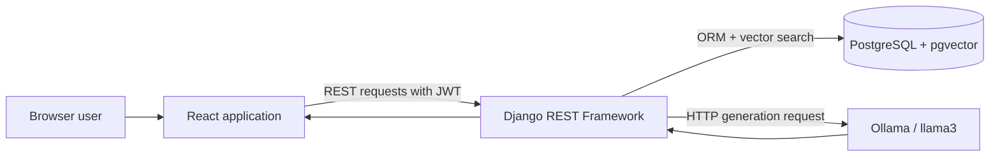
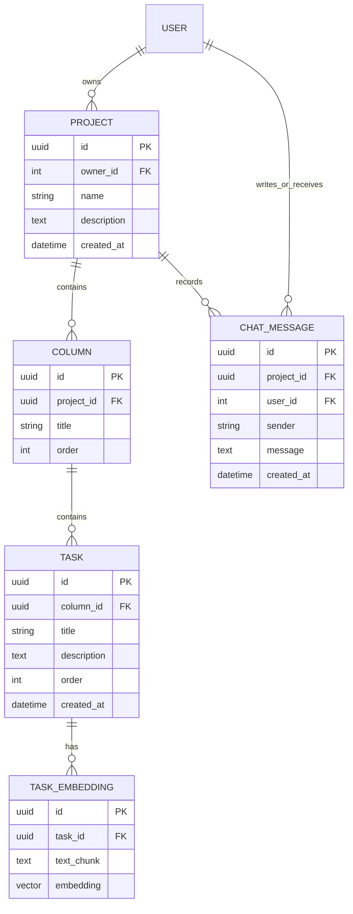
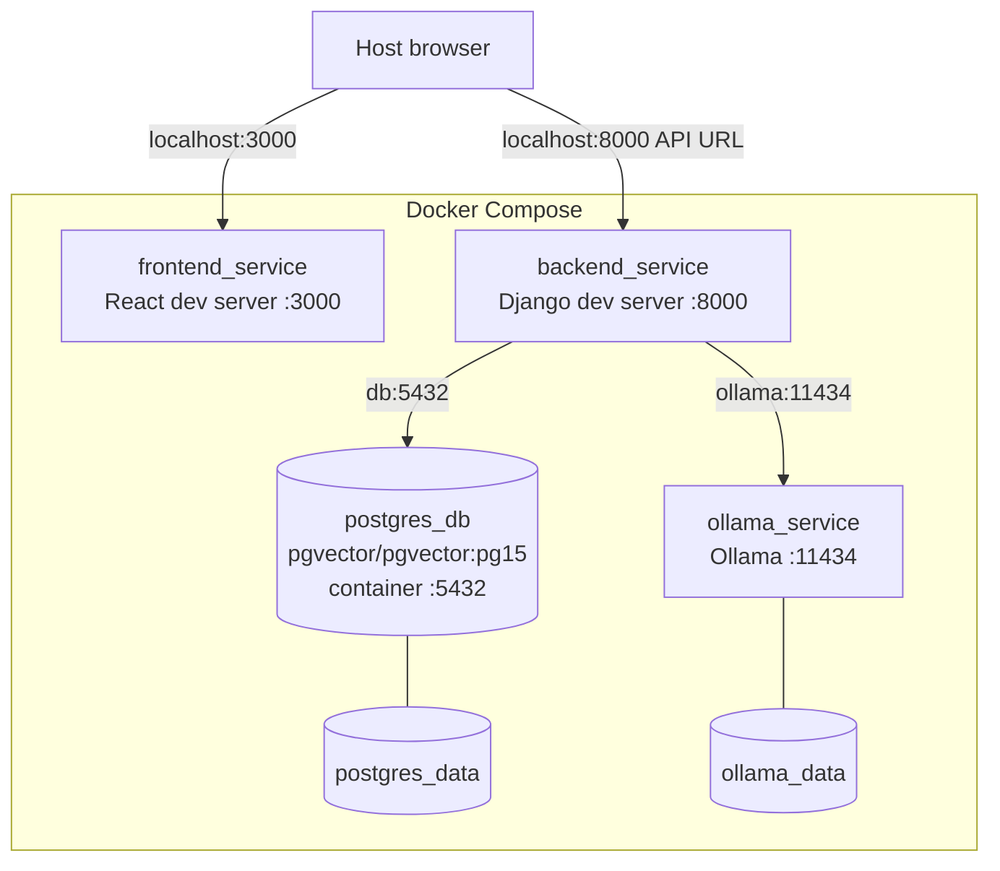

# Architecture

## System Overview

Project RAG Tracker is a browser-based project tracker with a semantic question-answering path alongside its Kanban workflow. The React application sends JSON requests to a Django REST API. Django persists users, projects, columns, tasks, task embeddings, and chat messages in PostgreSQL. For project questions, Django retrieves task context through pgvector and calls Llama 3 through Ollama.

The codebase is organized as a single repository with independently containerized frontend and backend applications.

## Components

### React frontend

The TypeScript frontend provides four primary views:

- a username/password login form;
- a project list with project creation and deletion;
- a project board containing the Kanban columns, tasks, and RAG chat;
- a user administration screen.

Material UI supplies the component system, React Router defines client-side routes, Axios performs API requests, and `dnd-kit` implements column and task drag and drop. Authentication state and tokens are held by `AuthContext` and persisted in browser `localStorage`.

### Django REST backend

Django REST Framework exposes model viewsets for projects, columns, tasks, and users. Project creation assigns the authenticated user as owner. The project, column, and task querysets are scoped to that ownership relationship.

The project viewset also exposes two custom actions:

- `GET /api/projects/{id}/history/` returns the current user's stored chat messages for the project.
- `POST /api/projects/{id}/ask/` runs retrieval and generation, persists both sides of the exchange, and returns the generated answer.

Django signals connect task persistence to embedding generation. The backend loads `all-MiniLM-L6-v2` for both task indexing and question encoding.

### PostgreSQL / pgvector

PostgreSQL stores the relational domain model and the 384-dimensional vector attached to each indexed task. Migration `0001_initial` enables the vector extension. Retrieval uses pgvector's Django `L2Distance` expression directly in an ORM query.

### Ollama

Ollama is a separate HTTP service. Django calls `http://ollama:11434/api/generate` with model `llama3`, a contextual prompt, and streaming disabled. Ollama model files persist in a named Docker volume.

## Request Flow

A typical Kanban request follows this path:

1. A component calls the configured `REACT_APP_API_URL` with Axios.
2. The Axios interceptor reads the stored JWT pair, refreshes an expired access token when possible, and adds the access token as a Bearer token.
3. Django REST Framework authenticates the token.
4. The relevant viewset scopes reads to the current user's project ownership, validates the serializer input, and executes the ORM operation.
5. PostgreSQL commits the change.
6. For task creates and updates, the `post_save` receiver synchronously replaces that task's embedding.
7. Django returns JSON and the frontend refreshes its project state.

The project serializer nests read-only columns, and each column serializer nests read-only tasks. Loading one project therefore supplies the board hierarchy used by the UI.

## Authentication

Authentication uses Django's built-in `User` model, Django REST Framework, Djoser, and Simple JWT.

- `POST /auth/jwt/create/` accepts credentials and returns an access/refresh pair.
- The customized token serializer adds `username` to the JWT payload.
- The frontend decodes the access token to populate the current user.
- Protected React routes redirect unauthenticated browser sessions to `/login`.
- The Axios request interceptor refreshes an expired access token through `/auth/jwt/refresh/` and logs out after a failed refresh or a `401` response.
- Project, column, and task viewsets require an authenticated request.

Tokens are stored in browser `localStorage`. No separate server-side frontend session layer is present.

## Domain Model

### User

The standard Django user is the authentication identity, project owner, and chat-message user. A separate user serializer exposes `id`, `username`, `is_active`, and `is_staff` through the user viewset.

### Project

A project has a UUID, owner, name, optional description, creation timestamp, ordered columns, and chat messages. The project serializer returns its columns as a nested read-only collection.

### Column

A column belongs to one project and has a title and positive integer `order`. The model's default ordering is ascending by that field. Tasks are returned as a nested read-only collection.

### Task

A task belongs to one column and contains a title, optional description, positive integer `order`, and creation timestamp. The serializer exposes the mutable column foreign key so drag and drop can move a task.

### TaskEmbedding

A task embedding stores the exact text used for indexing and a 384-dimensional pgvector value. Although the relationship permits multiple records, the signal deletes all previous embeddings for a task and creates one replacement after each save.

### ChatMessage

A chat message belongs to both a project and a user. `sender` distinguishes `user` from `ai`; the message body and creation time preserve the conversation. Default ordering is chronological.

All domain relationships use cascading deletion. Deleting a project therefore removes its columns, tasks, embeddings, and chat messages; deleting a column removes its tasks and their embeddings.

## Kanban Flow

1. The board loads a project with nested columns and tasks, then sorts each column's tasks by `order` in the browser.
2. New columns receive `project` and an order equal to the current column count plus one.
3. New tasks receive `column` and an order equal to the current task count plus one.
4. Column titles and task title/description fields are edited through `PATCH` requests.
5. Reordering columns updates local state, then sends one `PATCH` per column with its new one-based order.
6. Reordering tasks within a column follows the same pattern, sending one `PATCH` per task with its new one-based order.
7. Moving a task across columns updates the task's `column` foreign key, then reloads the project. The current implementation does not assign a new order in that cross-column request.
8. Deletions are confirmed in the UI and persisted through the corresponding REST endpoint.

The frontend uses optimistic local updates for drag results and subsequently reloads data after a cross-column move. The backend remains responsible for persistence; it does not contain a separate Kanban workflow engine.

## AI Integration

Task saves trigger embedding replacement. Project questions are encoded with the same model, matched only against embeddings reached through the selected project, and limited to the three nearest records by L2 distance. Their stored task text becomes prompt context for the `llama3` generation request.

The complete implementation is documented in [RAG Pipeline](rag-pipeline.md).

## Container Architecture

Compose publishes frontend `3000`, backend `8000`, Ollama `11434`, and PostgreSQL host port `5433` (mapped to container port `5432`). Source directories are bind-mounted into the two application containers for development. Named volumes preserve database and model data.

## Architectural Boundaries

| Boundary | Current responsibility |
| --- | --- |
| Frontend | Routes, forms, dialogs, board rendering, drag state, local optimistic updates, JWT storage/refresh, and chat presentation. |
| Backend | Authentication integration, owner-scoped domain API, serialization, ORM writes, embedding lifecycle, vector retrieval, prompt construction, Ollama orchestration, and chat persistence. |
| PostgreSQL | Relational integrity, ordered domain data, chat records, task text used for retrieval, and vector storage/distance calculation. |
| Ollama | Local execution of the named `llama3` generation model from a prompt supplied by Django. |

These boundaries describe the checked-in implementation. There is no background job queue, separate embedding service, reverse proxy, or production deployment layer in the repository.
