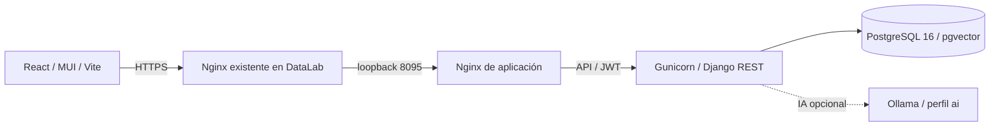

# Arquitectura

El despliegue inicial no carga modelos ML. PostgreSQL vive en una red interna y un volumen propios del proyecto Compose; el backend no publica puertos. Nginx del frontend sirve la SPA, reenvía API/auth/admin y recibe el protocolo HTTPS del proxy confiable del host. WhiteNoise sirve los estáticos de Django. Ver [README](../README.md) para pasos y límites de confianza del proxy.

## Frontend

- `pages`: login y tarjetas de proyectos con búsqueda, estados vacíos y errores.
- `layout/MainLayout`: navegación responsive, acceso de administración condicionado al usuario verificado y salida de sesión.
- `ProjectBoard`: coordina componentes sin contener la implementación de tarjetas, columnas o chat.
- `board`: tipos compartidos, `ColumnPanel`, `TaskCard`, `AssistantPanel` y transformación pura `moveItem`.
- `hooks/useProject`: carga y mutaciones, bloqueo de envíos concurrentes y resincronización tras errores.
- `components`: confirmaciones y notificaciones no intrusivas.
- `api/session` y `axiosInstance`: lectura defensiva de JWT, refresh compartido y un único reintento ante 401. `AuthContext` consulta `/api/me/` para los permisos actuales; no confía en una marca de administrador decodificada por el navegador.

El drag & drop usa asas separadas para no bloquear la apertura de tareas. Admite teclado y las tareas pueden cambiar de columna también mediante su formulario. `/reorder/` guarda el tablero completo atómicamente, sin emitir señales de embeddings por cambios de orden.

## Dominio y permisos

Un `User` tiene proyectos; cada `Project` tiene columnas; cada `Column` tiene tareas. `TaskEmbedding` guarda vectores de 384 dimensiones y `ChatMessage` guarda conversaciones por proyecto/usuario. Las migraciones conservan este esquema.

Los querysets y la validación de padres aplican el propietario al leer, crear, editar o eliminar. Las tareas se mueven solo dentro de su proyecto y las columnas no se reasignan. El payload de reorder debe contener exactamente las columnas y tareas actuales, sin IDs duplicados o externos; los layouts obsoletos se rechazan con 409.

La API de usuarios exige staff. Un staff solo modifica miembros; un superusuario puede conceder staff y editar administradores. Nadie puede asignar superusuario por esta API, eliminarse a sí mismo o desactivar su propio acceso administrativo. Las contraseñas se validan y se guardan con `set_password`/`create_user`. No hay registro público.

Simple JWT emite access de diez minutos y refresh de un día. El rol se obtiene con `/api/me/`. Los JWT persisten en localStorage: su exposición a XSS y la ausencia de revocación de refresh al cerrar sesión están documentadas en el README.

## Límite de IA

`api/ai.py` no importa bibliotecas ML al cargar Django. Solo `embedding_model()` importa Sentence Transformers, bajo demanda, y comparte una instancia por proceso. `AI_ENABLED` controla preguntas y `EMBEDDINGS_ENABLED` controla generación de vectores; RAG necesita ambos. Las dependencias opcionales están separadas en `requirements-ai.txt` y el perfil Compose de Ollama no es una dependencia de servicios esenciales.

Con embeddings apagados, las tareas funcionan sin modelos. Al editar una tarea se eliminan vectores anteriores para no dejar contexto obsoleto. Al activar embeddings después, ejecuta `reindex_tasks` en una ventana de mantenimiento. Ver [RAG](rag-pipeline.md).
