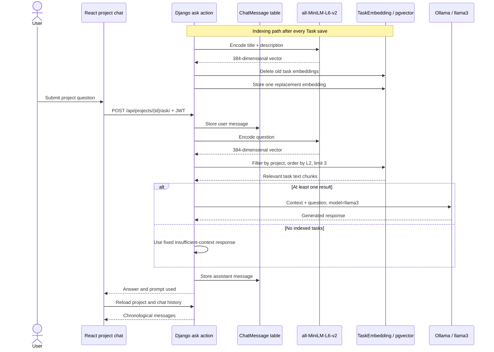

# RAG Pipeline

## Purpose

The RAG path lets a user ask natural-language questions about work recorded on a specific project board. Instead of sending the entire board to the language model, the backend retrieves the task records whose embeddings are closest to the question and supplies only those records as context.

This adds semantic access to the existing task data: retrieval can match related meaning even when the question does not use the exact words in a task title.

## Indexing

Each `Task` is indexed as one text record. The signal constructs the source text exactly as follows:

```text
Título: <task title>. Descripción: <task description or empty string>
```

There is no multi-chunk splitting, metadata document, or separate column/project text in the embedding input. Project scope is recovered through the relational path from `TaskEmbedding` to `Task`, `Column`, and `Project`.

## Embedding Model

Both indexing and retrieval use Sentence Transformers model `all-MiniLM-L6-v2`. It produces a 384-dimensional vector, matching the `VectorField(dimensions=384)` declared by `TaskEmbedding`.

The model is instantiated in two backend modules:

- `api.signals` uses it for task indexing;
- `api.views` uses it for question embedding.

Model loading occurs when those modules are imported. On a machine without a cached copy, the first backend start may need to download the model.

## Embedding Lifecycle

`ApiConfig.ready()` imports the signals module when the Django application starts. Its `post_save` receiver runs synchronously after every `Task` create or update:

1. Combine the saved title and description into the text record.
2. Encode that text with `all-MiniLM-L6-v2`.
3. Delete every existing `TaskEmbedding` associated with the task.
4. Create one replacement row containing `text_chunk` and the new vector.

Task deletion cascades to its embeddings through the database relationship. There is no checked-in management command for bulk indexing existing tasks and no background worker; embedding work happens in the request process that saved the task.

Because all task saves trigger the signal, changing only a task's column or order also regenerates its embedding even though the indexed title and description may be unchanged.

## Vector Storage

`TaskEmbedding` contains:

- a UUID primary key;
- a foreign key to `Task` with cascading deletion;
- `text_chunk`, preserving the string that was embedded;
- a 384-dimensional pgvector `VectorField`.

The initial API migration enables PostgreSQL's vector extension. The project uses the `pgvector/pgvector:pg15` Docker image, so the extension binaries are present in the database container.

No approximate nearest-neighbor index is declared in the models or migrations. Retrieval is expressed as an ordered distance query through the Django ORM.

## Retrieval

`POST /api/projects/{project_id}/ask/` accepts a JSON `question` value. The project is resolved through the authenticated user's project queryset before retrieval begins.

For a non-empty question, the backend:

1. Encodes the question with `all-MiniLM-L6-v2`.
2. Filters `TaskEmbedding` rows by `task__column__project=project`.
3. Orders rows by `L2Distance('embedding', question_embedding)`.
4. Selects the first three rows.

The metric is Euclidean/L2 distance, and the retrieval limit is exactly three. There is no score threshold, reranker, hybrid keyword search, or chat-history input in the retrieval query.

## Context Construction

When at least one row is retrieved, the backend starts a Spanish context block:

```text
Contexto de las tareas del proyecto:
```

It then adds each retrieved `text_chunk` as a bullet. Because the stored chunk already contains the task's title and description, those are the only task fields exposed to the generation prompt. Column name, task order, timestamps, project description, and similarity scores are not added.

If the project has no task embeddings, Ollama is not called. The backend returns and stores a fixed Spanish response stating that there is not enough project information.

## Generation

The context and original question are placed in a Spanish prompt instructing the model to answer concisely and in a friendly manner. Django sends a synchronous `POST` request to:

```text
http://ollama:11434/api/generate
```

The request body selects `llama3`, supplies the prompt, and sets `stream` to `false`. The HTTP timeout is 180 seconds. The backend reads the `response` field from Ollama's JSON result.

If the Ollama request fails, the caught request error is converted into an error string and used as the assistant answer. The API response includes both `answer` and `prompt_used`; the current frontend reloads history after the request rather than rendering those response fields directly.

## Chat History

Before embedding the question, the endpoint stores it as a `ChatMessage` with `sender='user'`. After retrieval/generation (including the no-context and request-error paths), it stores the answer with `sender='ai'`.

`GET /api/projects/{project_id}/history/` returns messages for that project filtered to the authenticated user. The model orders them by `created_at`, so the frontend receives a chronological conversation. Each serialized message exposes `sender`, the message body as `text`, and `created_at`.

Stored history is for display and persistence only. Previous turns are not included in question embedding, retrieval, or the generation prompt.

## Full Pipeline



## Current Limitations

These are observable boundaries of the current implementation, not proposed architecture:

- Each task is a single retrieval unit; long descriptions are not chunked.
- Retrieval uses a fixed top-three result count without a relevance threshold.
- No vector index is declared, so the repository does not configure approximate nearest-neighbor search.
- Column names and other project metadata are not part of the indexed text.
- Chat history is persisted but is not used to make follow-up questions conversationally aware.
- Embedding generation is synchronous and repeats for order-only or column-only task updates.
- The embedding model is instantiated separately in the signal and view modules.
- Ollama errors are stored and returned as assistant messages, and the error string may include connection details.
- The API returns the complete prompt in `prompt_used`, although the current UI does not display it.
- The `llama3` model must already be available in Ollama; Compose starts the runtime but does not pull the model.
